# Margem

*An augmented reader: Codex reads along with you, marks what each passage does, and keeps your highlights, notes and questions anchored to the text. Local app, Portuguese interface.*

<p align="center">
  
</p>

**Tenha uma formação integral.** O Margem é um ambiente de estudos para livros, artigos, poemas,
vídeos e obras de arte. Ele mostra o que cada trecho faz e como se liga aos outros. Não torna o
estudo mais rápido: torna-o mais profundo.

Site: <https://margem.dev> · Código: <https://github.com/pedropasinn/margem>

## O que é

Ler bem um texto difícil é perceber o que cada parte faz: onde está a tese, de onde vem o argumento,
qual objeção o autor está respondendo, que passagem retoma outra lá de trás. Um chat ao lado do PDF
ajuda pouco nisso, porque a conversa se solta do texto e some.

O Margem faz o contrário: tudo fica preso ao trecho.

- **O Codex lê junto com você.** Ao analisar um documento, ele grifa os trechos que importam e diz a
  função de cada um no tipo de texto em questão: tese e objeção num ensaio, voz narrativa e virada
  num conto, imagem e ritmo num poema. Cada grifo traz um comentário curto, que aparece na margem.
  Ele também liga trechos entre si ("responde a", "contrasta com", "desenvolve") e aponta as
  passagens difíceis: uma referência que o texto não explica, um salto no argumento.
- **Você trabalha sobre o mesmo texto.** Selecione um trecho para grifar, escolha a função e escreva
  a sua nota dentro do grifo. Pergunte sobre o trecho: a resposta cita os parágrafos em que se apoia
  e fica guardada ali. Conecte o trecho a outro, do mesmo documento ou de outro.
- **O original continua no centro.** O PDF aparece como foi publicado, com os grifos por cima. O
  texto não é reescrito nem resumido no lugar do original.

## Para quem é

Para quem estuda por conta própria ou na faculdade e lê coisas que pedem atenção: filosofia,
literatura, economia, direito, teologia, ciência, matemática. Também para quem ensina e quer
preparar uma leitura. A interface é em português, e os modos de leitura foram pensados para textos
em português, mas o Margem lê material em outras línguas.

## Como funciona

- **Roda no seu computador.** O Margem é um app de desktop. A biblioteca (arquivos, banco de dados,
  grifos e notas) fica numa pasta que você escolhe. Não há conta no Margem, nem servidor nosso no
  meio, nem coleta de uso.
- **Usa a sua conta do ChatGPT.** As análises e respostas vêm do
  [Codex](https://github.com/openai/codex), pela sua assinatura do ChatGPT, num plano que inclua o
  Codex. Não é preciso chave de API nem outra mensalidade. Você escolhe o modelo e o esforço de cada
  tipo de tarefa em Configurações.

  <details>
  <summary>Configurações → Modelos</summary>

  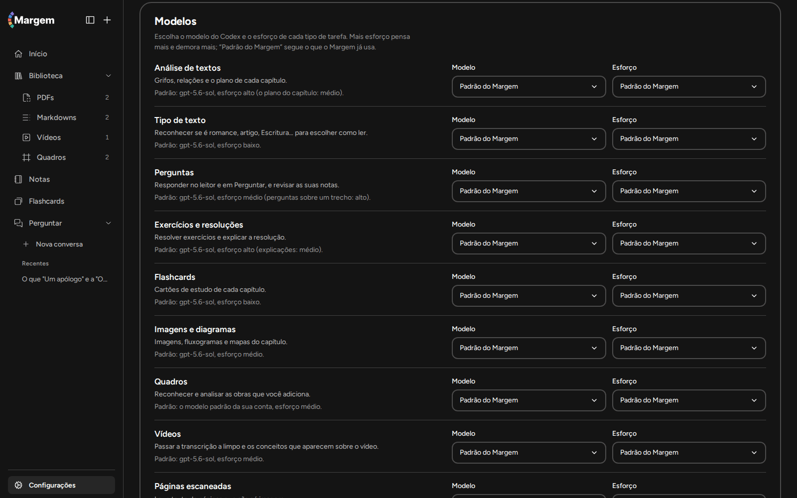

  </details>
- **O que sai do computador.** Só vai para a rede o que você pede: o trecho e o contexto de que o
  Codex precisa para responder, o vídeo do YouTube que você importa, a pesquisa de uma obra de arte
  no Wikidata e na Wikipédia e, se você ligar, a narração pela sua chave da ElevenLabs.
- **Ler não gasta cota.** Grifar, anotar, conectar e reler o que já foi preparado funciona sem o
  Codex. Se a cota acabar, os pedidos esperam na fila e continuam sozinhos depois.

## Tour

As imagens abaixo são do app de verdade, com textos em domínio público. Para refazê-las, veja
[Desenvolver](#desenvolver).

### Um PDF, como foi publicado

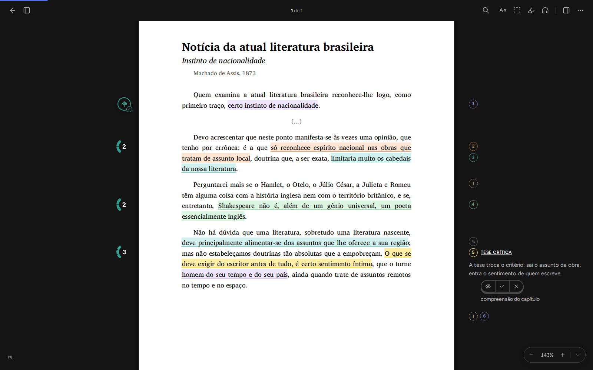

O ensaio de Machado de Assis na página original. Cada cor é uma função da crítica literária
(tese, evidência, critério, interlocução). O comentário do grifo aberto fica na margem, ao lado do
trecho.

### Relações entre trechos

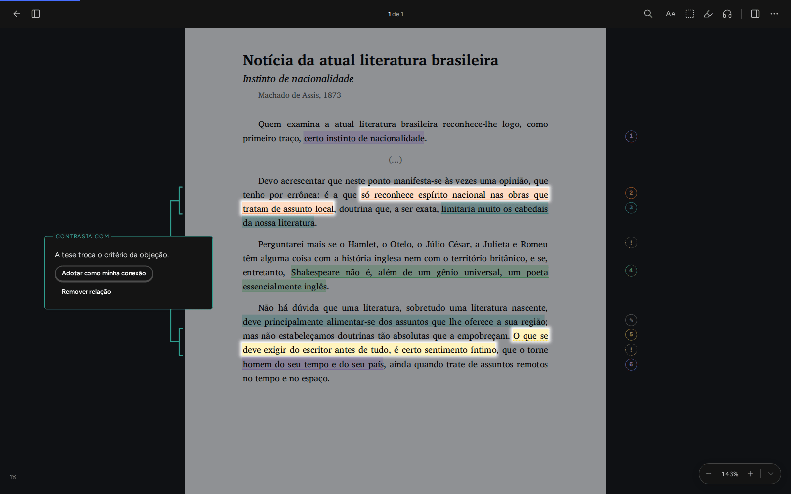

Um clique na margem esquerda mostra como a tese se liga à objeção que ela recusa, com a explicação
da relação.

### Um vídeo, com a transcrição grifada

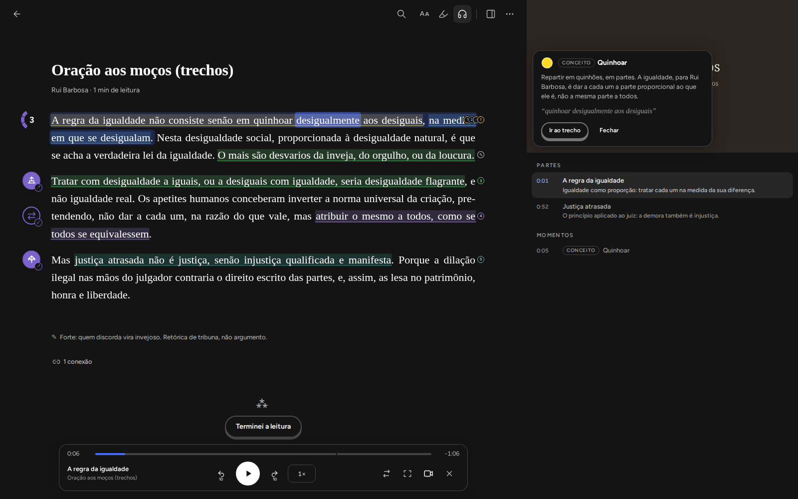

Vídeos do YouTube pelo link, ou vídeo e áudio seus com a transcrição. O texto acompanha a fala, um
clique leva o vídeo ao trecho, e a transcrição recebe a mesma análise de um texto.

### Uma obra de arte, identificada e analisada

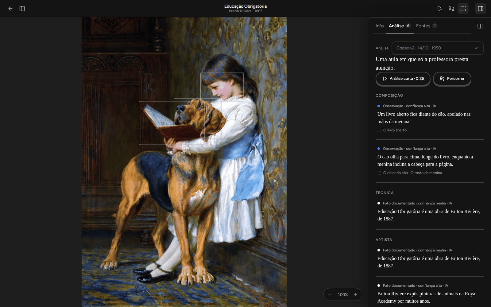

Envie a imagem de uma obra. O Margem procura a obra em fontes abertas, identifica título, artista e
data, e prepara uma análise que separa o que se vê, o que está documentado e o que é interpretação.
Dá para percorrer as regiões ou ouvir a análise curta.

### Exercícios resolvidos passo a passo

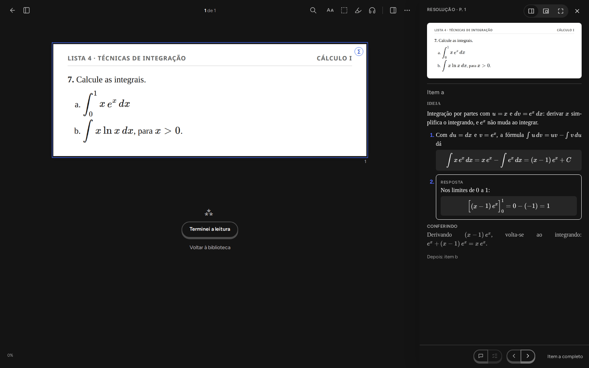

Cole o print de uma questão (ou recorte-a num PDF). A resolução começa pela ideia, e cada passo só
aparece quando você pede. Dá para perguntar sobre um passo.

### A página do documento

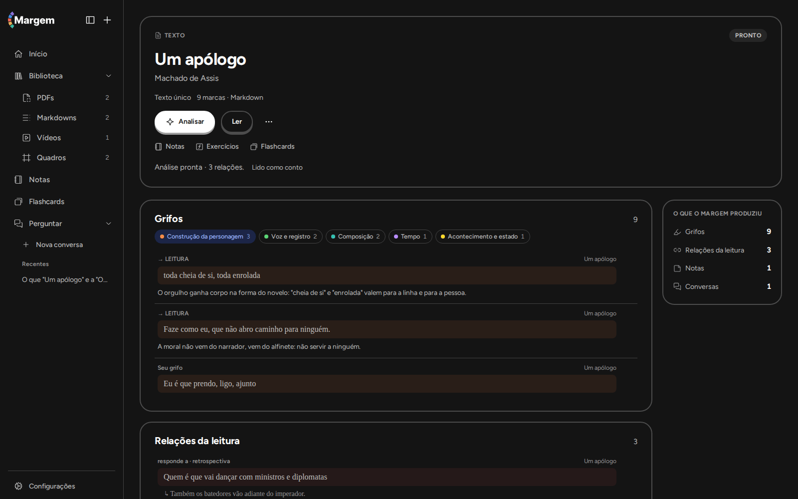

**Analisar** reconhece o tipo de texto (aqui, um conto) e lê com o modo de leitura certo. A página
mostra o que o Codex produziu, agrupado por função, e o que você acrescentou.

### O leitor

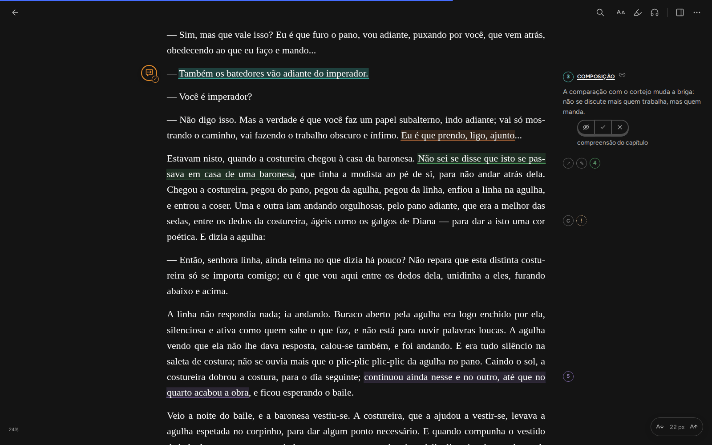

Texto, Markdown e EPUB aparecem como página de leitura. Os grifos do Codex trazem a função e um
comentário; os ícones da margem indicam a sua nota, uma conversa sobre o trecho, uma conexão e uma
dificuldade.

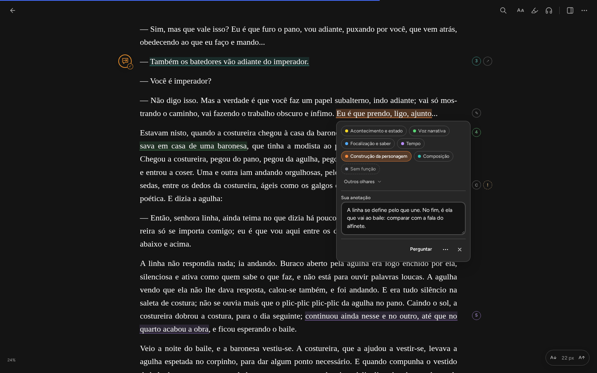

O balão de um grifo: as funções do modo de leitura do texto (aqui, ficção narrativa), as de outros
modos em "Outros olhares" e a sua nota, que se salva sozinha.

### Perguntar à biblioteca

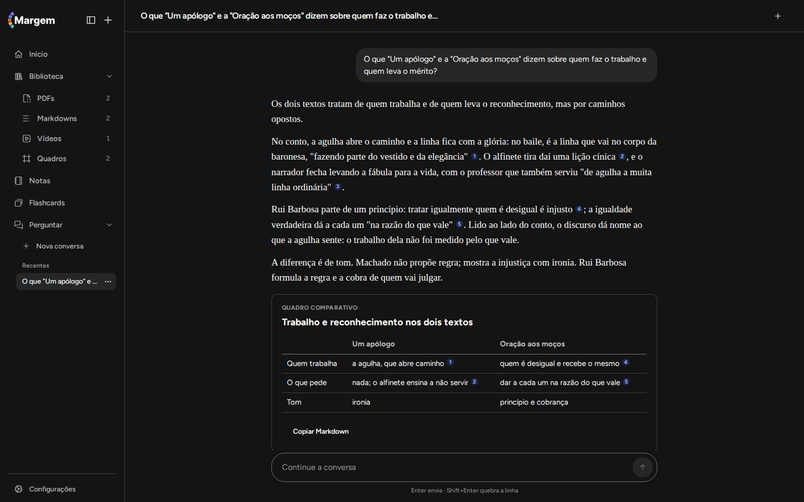

Uma conversa sobre a biblioteca inteira. Cada afirmação vem com a citação do trecho em que se
apoia, e um clique leva ao lugar no texto.

### Notas e biblioteca

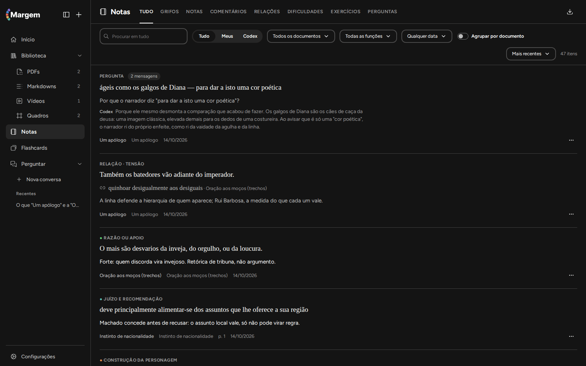

Notas reúne, num lugar só, o que você grifou e anotou em todos os documentos, com busca e
exportação em CSV e JSON.

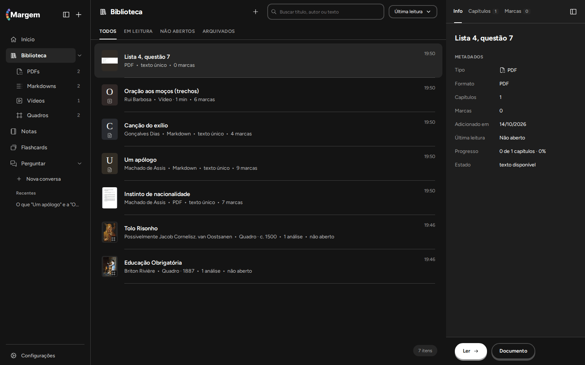

## O que entra na biblioteca

| Material | Como |
| --- | --- |
| PDF | Aparece como o original. PDF escaneado: as páginas sem texto podem ser transcritas. |
| EPUB | Com os capítulos do próprio livro. |
| Markdown, texto e texto colado | Em prosa ou poesia. |
| Página da web | Pela extensão do navegador. |
| Vídeo do YouTube | Pelo link; o texto vem das legendas do próprio vídeo. |
| Vídeo e áudio seus | Junto com a transcrição em JSON. |
| Print de questão | Cole ou solte: vira uma página e a resolução começa. |
| Obra de arte | JPEG, PNG ou WebP, na aba Quadro de Adicionar. |

## Integrações

- **Obsidian.** O plugin leva grifos, relações e notas para o seu cofre, um arquivo Markdown por
  item, com o link de volta para o trecho. Código em [`integracoes/obsidian/`](integracoes/obsidian/).
- **Extensão de navegador** (Chrome, Edge, Brave e Firefox). Manda para o Margem o artigo ou o PDF
  aberto no navegador. Código em [`extensao/`](extensao/).
- **Narração** (opcional), com a sua chave da ElevenLabs.

## Instalar

Nesta primeira versão, o Margem é para **Windows e Linux**. A versão para macOS vem em breve.

| Sistema | Arquivo |
| --- | --- |
| Windows 10/11 (64 bits) | `Margem-Setup.exe` |
| Linux x86_64 | `Margem-linux-x86_64.AppImage` ou `margem_amd64.deb` |
| macOS | em breve |

Baixe em <https://margem.dev/download/> ou no
[último release](https://github.com/pedropasinn/margem/releases/latest). O instalador traz tudo o
que o app precisa (leitor, banco de dados e Codex).

Na primeira vez, o app pede a pasta da biblioteca e abre o navegador para você entrar com a sua
conta do ChatGPT. Depois disso, ele se atualiza sozinho. Backup é copiar a pasta da biblioteca com
o app fechado.

O app ainda não tem assinatura digital, então o Windows (SmartScreen) avisa na primeira vez. O
passo a passo está em <https://margem.dev/docs/instalacao/>.

## Estado do projeto

Esta é a primeira versão pública. O núcleo (biblioteca, leitor, análise, perguntas, notas, quadros,
exercícios e vídeos) funciona e é usado no dia a dia, mas espere arestas: telas que ainda vão mudar,
modos de leitura em avaliação e análises que às vezes erram a função de um trecho. Tudo o que o
Codex marca pode ser corrigido ou apagado, e apagar pede confirmação.

Relate problemas e ideias em <https://github.com/pedropasinn/margem/issues>.

## Desenvolver

A interface React (`web/`) fala com uma API Node (Hono, em `servico/`). A API guarda documentos e
enfileira trabalhos no PostgreSQL. Um worker separado roda o motor Python (`motor/`), que prepara o
texto e a geometria dos documentos, e chama `codex exec` para as leituras e respostas. Só o serviço
grava no banco: o motor e o modelo devolvem dados que o serviço valida. O modelo devolve o bloco e a
citação literal, e o serviço resolve onde ela está no texto; citação ambígua vira aviso, nunca
escolha silenciosa.

| Pasta | Responsabilidade |
| --- | --- |
| `web/` | Biblioteca, leitor de PDF e de texto, componentes e testes visuais |
| `servico/` | API, PostgreSQL, fila, worker, executor do Codex e consultas |
| `motor/` | Extração de texto, estrutura e geometria (Python) |
| `core/` | Regras puras de âncoras, texto, segmentos e geometria |
| `contratos/` | Schemas JSON versionados, tipos, validações e modos de leitura |
| `prompts/` | Instruções e formatos versionados das leituras e respostas |
| `desktop/` | App de desktop (Electron) e instaladores |
| `extensao/` | Extensão de navegador |
| `integracoes/` | Plugin do Obsidian |
| `site/` | Site e documentação |
| [`fixtures/`](fixtures/README.md) | Dados de teste compartilhados |
| [`tests/`](tests/README.md) | Cenários de ponta a ponta entre API, worker, motor e navegador |
| `tools/` | Ferramentas de desenvolvimento e importação |

As regras do projeto estão em [`AGENTS.md`](AGENTS.md); as decisões de arquitetura, em
[`docs/desenho/03-DECISOES.md`](docs/desenho/03-DECISOES.md).

Requisitos: Node >= 22.12 (`.nvmrc`), Python >= 3.12 e um PostgreSQL de desenvolvimento (como subir:
[`ops/desenvolvimento-local.md`](ops/desenvolvimento-local.md)).

```sh
npm ci
python3 -m venv motor/.venv && motor/.venv/bin/pip install -r motor/requirements.txt
npm run dev          # API, worker e a interface em http://localhost:5180
```

Detalhes do motor em [`motor/README.md`](motor/README.md). Para rodar ao lado de outra instância,
use `MARGEM_PORTA`, `MARGEM_PORTA_WEB`, outro banco e outra pasta de dados (`MARGEM_DADOS`). A API
aplica as migrações ao subir.

Verificações (sem rede: os testes usam um executor do Codex falso e bancos de teste que eles mesmos
criam e apagam):

```sh
npm run typecheck
npm run lint
npm test
motor/.venv/bin/pytest motor/tests
npm run build --workspace web
```

As imagens deste README saem de um roteiro que sobe o app com um banco de teste descartável, semeia
textos em domínio público e análises determinísticas (sem chamar o Codex) e fotografa as telas:

```sh
npm run build --workspace web && (cd site && npm ci && npm run build)
cd servico && node --import tsx src/ferramentas/capturar-readme.ts   # ou --so=pdf,video, ou --servir
```

## Contribuir

Antes de mandar código, abra um item em <https://github.com/pedropasinn/margem/issues> descrevendo a
mudança. Faça mudanças pequenas, com testes, e rode as verificações acima. Detalhes em
[`CONTRIBUTING.md`](CONTRIBUTING.md). No primeiro pull request, o CLA Assistant pede que você assine
o [acordo de contribuição](CLA.md): ele permite que o projeto ofereça outras licenças, inclusive
comerciais, sem tirar de ninguém os direitos da AGPL. Não anexe livros nem textos protegidos por
direitos autorais. Falhas de segurança: veja [`SECURITY.md`](SECURITY.md).

## Licença

[GNU Affero General Public License v3.0](LICENSE) (AGPL-3.0-only). Se você modificar o Margem e
oferecê-lo a outras pessoas pela rede, a AGPL pede que o código-fonte modificado fique disponível a
elas.
